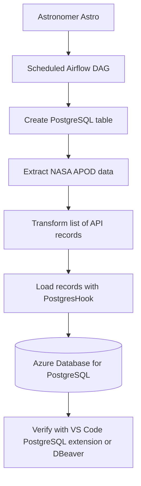

# NASA APOD ETL Pipeline with Apache Airflow, Astronomer Astro, and Azure PostgreSQL

A practical MLOps/data-engineering project that extracts NASA Astronomy Picture of the Day (APOD) data, transforms the response, and stores the records in an Azure Database for PostgreSQL server using an Apache Airflow DAG deployed with Astronomer Astro.

> **Security note:** Never commit real API keys, database passwords, connection exports, `.env` files, or screenshots containing secrets. This README uses connection IDs and placeholders, not secret values.

---

## Table of Contents

- [Project Overview](#project-overview)
- [Architecture](#architecture)
- [Technology Stack](#technology-stack)
- [How the Pipeline Works](#how-the-pipeline-works)
- [Repository Structure](#repository-structure)
- [Prerequisites](#prerequisites)
- [1. Install and Verify Docker Desktop](#1-install-and-verify-docker-desktop)
- [2. Install and Configure Astro CLI](#2-install-and-configure-astro-cli)
- [3. Create the Airflow Project](#3-create-the-airflow-project)
- [4. Configure the NASA API Connection](#4-configure-the-nasa-api-connection)
- [5. Create Azure Database for PostgreSQL](#5-create-azure-database-for-postgresql)
- [6. Configure Azure Networking and SSL](#6-configure-azure-networking-and-ssl)
- [7. Configure the PostgreSQL Connection in Airflow](#7-configure-the-postgresql-connection-in-airflow)
- [8. DAG and Database Schema](#8-dag-and-database-schema)
- [9. Deploy to Astro](#9-deploy-to-astro)
- [10. Run and Monitor the DAG](#10-run-and-monitor-the-dag)
- [11. Verify the Data in PostgreSQL](#11-verify-the-data-in-postgresql)
- [Configuration Reference](#configuration-reference)
- [Troubleshooting Notes](#troubleshooting-notes)
- [Important Implementation Details](#important-implementation-details)
- [Future Improvements](#future-improvements)

---

## Project Overview

This pipeline demonstrates an end-to-end scheduled ETL workflow:

1. **Extract:** call NASA's APOD-related endpoint through Airflow's `HttpOperator`.
2. **Transform:** handle the API response as a list of dictionaries and select the fields needed for storage.
3. **Load:** insert each transformed record into an Azure-hosted PostgreSQL table using `PostgresHook`.
4. **Orchestrate:** schedule and monitor the tasks through Apache Airflow.
5. **Deploy:** package and deploy the Airflow project using Astronomer Astro.
6. **Verify:** query the table using a PostgreSQL client such as the VS Code PostgreSQL extension or DBeaver.

The project is an ETL/MLOps learning project: it demonstrates orchestration, connections, cloud networking, deployment, logging, task dependencies, and persistent storage. It is not a machine-learning model training pipeline.

## Architecture



**Data flow:** NASA API → Airflow `HttpOperator` → transform task → Airflow `PostgresHook` → Azure PostgreSQL.

The Airflow tasks run in the Astro deployment environment. The database is hosted separately on Azure, so the Astro environment must be able to reach the Azure PostgreSQL server over the network.

## Technology Stack

| Technology | Purpose |
|---|---|
| Python | ETL task logic |
| Apache Airflow | DAG scheduling, orchestration, retries, logs, task status |
| Astronomer Astro CLI / Astro Runtime | Local project tooling, container-based development, deployment to Astro |
| Docker Desktop | Runs the local container environment used by Astro CLI |
| NASA APOD-related endpoint | Source data |
| `HttpOperator` | Makes the HTTP request from the DAG |
| `@task` TaskFlow API | Defines Python tasks and passes data through XCom |
| `PostgresHook` | Executes SQL against PostgreSQL |
| Azure Database for PostgreSQL Flexible Server | Managed cloud database |
| VS Code PostgreSQL extension / DBeaver | Connects to PostgreSQL and runs SQL queries |
| Git / GitHub (optional) | Version control and project portfolio |

---

## How the Pipeline Works

The DAG ID is `nasa_apod_postgres`, and the schedule is `@daily`.

The DAG contains these tasks:

| Task | Responsibility |
|---|---|
| `create_table` | Creates `apod_data` if it does not exist |
| `extract_apod` | Requests JSON from the NASA endpoint |
| `transform_apod_data` | Normalizes the response and keeps selected columns |
| `load_apod_to_postgres` | Inserts each transformed record into PostgreSQL |

The intended dependency order is:

```text
create_table → extract_apod → transform_apod_data → load_apod_to_postgres
```

Airflow passes the output of `extract_apod` to the transform task, then passes the transformed output to the load task. Task outputs are passed through Airflow's XCom mechanism; do not manually pass Python objects between worker processes.

## Repository Structure

An Astro project commonly looks like this:

```text
ETLpipeline/
├── dags/
│   └── etl.py                 # DAG definition and ETL tasks
├── include/                   # Optional supporting files
├── plugins/                   # Optional custom Airflow plugins
├── tests/                     # Optional DAG tests
├── Dockerfile                 # Astro Runtime image configuration
├── requirements.txt           # Additional Python packages/providers
├── packages.txt               # Optional OS-level packages
├── airflow_settings.yaml      # Optional local Airflow connections/variables
└── README.md
```

Your exact folders may differ depending on how the Astro project was initialized. Keep DAG Python files in the `dags/` directory so Airflow can discover them.

---

## Prerequisites

- Windows with PowerShell or Windows Terminal
- Docker Desktop installed and running
- Astro CLI installed
- An Astronomer account and an Astro deployment
- An Azure subscription with permission to create a PostgreSQL Flexible Server
- A NASA API key, if required by the endpoint/configuration being used
- VS Code with a PostgreSQL extension, or DBeaver, for database verification
- Git (optional)

Verify Docker:

```powershell
docker --version
docker ps
docker run hello-world
```

`docker ps` should run without a Docker daemon connection error. If Docker Desktop is not running, start it and wait until the engine is ready.

## 1. Install and Verify Docker Desktop

1. Install Docker Desktop for Windows.
2. Open Docker Desktop and wait for the engine to start.
3. Verify Docker from PowerShell:

   ```powershell
   docker --version
   docker ps
   docker run hello-world
   ```

4. If Astro is configured to use Docker, make sure Docker Desktop is running before using local Astro commands.

For this setup, the Astro CLI was configured to use Docker as its container binary:

```powershell
astro config set container.binary docker -g
```

The `-g` flag sets the configuration globally, so the setting applies when Astro CLI is run from different project folders.

## 2. Install and Configure Astro CLI

Install Astro CLI using the installation method supported by your environment. On this Windows setup, `winget` was used.

Verify the installation:

```powershell
astro version
astro config get container.binary
```

The installed CLI version during setup was `1.46.0`; your version may be newer.

Set Docker as the global container binary if needed:

```powershell
astro config set container.binary docker -g
```

Useful commands:

```powershell
astro version
astro dev start
astro dev stop
astro dev restart
astro deploy
```

- `astro dev start`: starts the local Airflow development environment.
- `astro dev stop`: stops the local environment.
- `astro dev restart`: restarts it.
- `astro deploy`: builds and deploys the project to the selected Astro deployment. Follow any CLI prompts and confirm the correct deployment before deploying.

## 3. Create the Airflow Project

If starting from scratch, initialize a project using Astro CLI:

```powershell
mkdir ETLpipeline
cd ETLpipeline
astro dev init
```

If the project already exists, do **not** initialize it again inside the existing project. Open PowerShell in the existing project directory instead.

Place the DAG file here:

```text
ETLpipeline/dags/etl.py
```

The project uses the Airflow providers for HTTP and PostgreSQL. If the runtime image does not already contain the providers, add compatible provider packages to `requirements.txt`, then rebuild/restart the local environment or redeploy the project as appropriate.

Example package names (choose versions compatible with your Astro Runtime rather than blindly pinning the latest versions):

```text
apache-airflow-providers-http
apache-airflow-providers-postgres
```

Do not install arbitrary Airflow versions into an Astro Runtime image. Astro Runtime manages the Airflow version; provider versions should be compatible with that runtime.

## 4. Configure the NASA API Connection

The DAG uses this Airflow connection ID:

```text
nasa_api
```

The source endpoint used after the legacy APOD endpoint began returning unsuitable responses was:

- **Base URL / host:** `https://science.nasa.gov`
- **Endpoint:** `wp-json/wp/v2/apod-basic/`
- **HTTP method:** `GET`

The resulting request URL is conceptually:

```text
https://science.nasa.gov/wp-json/wp/v2/apod-basic/
```

### Configure the connection in Airflow

In the Airflow UI for the environment where the DAG runs:

1. Open **Admin → Connections** (the menu wording may vary by Airflow version).
2. Add or edit the connection with ID `nasa_api`.
3. Set the connection type to **HTTP**.
4. Set the host to:

   ```text
   https://science.nasa.gov
   ```

5. Store the API key in the connection's **Extra** field only if the endpoint and current API configuration require it. Example structure:

   ```json
   {
     "api_key": "YOUR_NASA_API_KEY"
   }
   ```

   Replace the placeholder in the Airflow UI with your actual key. Do not put the real key in this README or commit it to Git.

The DAG template reads the key from the connection's Extra field:

```jinja
{{ conn.nasa_api.extra_dejson.api_key }}
```

**Endpoint/API note:** NASA's legacy `api.nasa.gov/planetary/apod/` endpoint and the newer `science.nasa.gov/wp-json/wp/v2/apod-basic/` endpoint do not necessarily have the same response schema or authentication requirements. Confirm the current endpoint's response and API-key requirements if NASA changes the service. The transform task must match the response shape returned by the configured endpoint.

## 5. Create Azure Database for PostgreSQL

The project uses Azure Database for PostgreSQL Flexible Server.

Known project configuration:

| Setting | Value |
|---|---|
| Azure server name | `abhishek-mlops-pg` |
| Server FQDN / host | `abhishek-mlops-pg.postgres.database.azure.com` |
| Administrator login | `abhishek` |
| Database used by the Airflow connection | `postgres` |
| Port | `5432` |
| SSL | Required |
| Region used during setup | Central India |
| PostgreSQL version observed during setup | 18.6 |

Azure Portal workflow (labels can change slightly):

1. Open the Azure Portal.
2. Search for **Azure Database for PostgreSQL flexible servers**.
3. Create a Flexible Server, or open the existing server `abhishek-mlops-pg`.
4. Under **Connect**, note the server FQDN, administrator login, database name, and required TLS/SSL settings.
5. Use the `postgres` database for this project unless you deliberately create a separate database.
6. Keep the administrator password in a password manager or secure secret store. Do not place it in source code, README, GitHub, or screenshots.

The administrator login is `abhishek` in the current setup. Use the exact login shown in the Azure server's connection information if Azure's UI presents a different required login format.

## 6. Configure Azure Networking and SSL

A cloud Airflow deployment must be allowed to connect to Azure PostgreSQL.

### Firewall / networking

In Azure Portal:

1. Open the PostgreSQL Flexible Server resource.
2. Open **Networking**.
3. Review the server's connectivity method and firewall rules.
4. Add only the outbound IP addresses that need database access, following the current Astro deployment's documented networking information.
5. Save the firewall rules and allow a short time for them to take effect.

During this project, the Astro deployment outbound IPs that were added were:

```text
52.24.52.182
54.190.182.111
```

These are project setup notes, **not guaranteed permanent IPs**. Verify the current outbound IP addresses in Astro before relying on these rules; deployments or infrastructure changes can affect network egress. Remove obsolete or overly broad firewall rules. Do not leave an allow-all IPv4 rule enabled just to make the connection work.

The laptop's public IP is relevant when connecting directly from VS Code or DBeaver. It is different from the Astro deployment's outbound IP. If your laptop's public IP changes, update the laptop access rule as needed. Keep database access restricted to known IPs.

### SSL / TLS

The Airflow PostgreSQL connection uses:

```json
{
  "sslmode": "require"
}
```

This instructs the PostgreSQL client to require an SSL-encrypted connection. Use the SSL/TLS mode recommended by your organization's security requirements and Azure documentation. For stricter certificate verification, configure the appropriate CA certificate and verification mode.

## 7. Configure the PostgreSQL Connection in Airflow

The DAG expects this connection ID:

```text
my_postgres_connection
```

In the Airflow UI for the Astro deployment:

1. Open **Admin → Connections**.
2. Add or edit the connection with ID `my_postgres_connection`.
3. Set the connection type to **Postgres**.
4. Fill in the fields:

| Field | Value |
|---|---|
| Connection ID | `my_postgres_connection` |
| Connection Type | `Postgres` |
| Host | `abhishek-mlops-pg.postgres.database.azure.com` |
| Database / Schema | `postgres` |
| Login | `abhishek` |
| Password | Your current Azure PostgreSQL password |
| Port | `5432` |
| Extra | `{"sslmode":"require"}` |

5. Save the connection.
6. If the UI offers a connection test, use it. Otherwise, trigger the DAG and inspect the task logs.

**Never copy the actual password into this README.** If authentication fails, verify the password in Azure or reset it securely, then update the Airflow connection. Do not paste the password into chat, GitHub, or logs.

### Why this connection matters

`PostgresHook(postgres_conn_id="my_postgres_connection")` retrieves these settings from Airflow's connection store. The DAG should not hard-code the database password or server details inside Python code.

## 8. DAG and Database Schema

### Table

The `create_table` task creates the following table if it does not exist:

```sql
CREATE TABLE IF NOT EXISTS apod_data (
    id SERIAL PRIMARY KEY,
    title VARCHAR(255),
    explanation TEXT,
    url TEXT,
    date DATE,
    media_type VARCHAR(50)
);
```

Column meanings:

| Column | Meaning |
|---|---|
| `id` | Auto-generated primary key |
| `title` | APOD item title |
| `explanation` | Text explanation or description |
| `url` | Image URL, preferring `hdurl` when available, or the available media URL |
| `date` | Date supplied by the API |
| `media_type` | Media type, such as `image` or `video` |

`CREATE TABLE IF NOT EXISTS` does not delete or reset existing data. It also does not modify an existing table's schema if the schema changes later.

### Important: API response is a list

The newer endpoint used in this project can return a **list of dictionaries**, rather than one dictionary. Therefore the transform task must loop over the list. The load task must also loop over the transformed records; otherwise only a single dictionary may be handled correctly or the task can fail with a type error.

The working logic should follow this pattern:

```python
if isinstance(api_response, dict):
    api_response = [api_response]

transformed_data = []

for item in api_response:
    # Select fields from each dictionary.
    ...
```

Then insert every transformed item into PostgreSQL.

### Task dependencies

The DAG should express the dependency order explicitly:

```python
create_table() >> extract_apod
api_response = extract_apod.output
transformed_data = transform_apod_data(api_response)
load_apod_to_postgres(transformed_data)
```

The `@task` decorator creates TaskFlow tasks. `extract_apod.output` is an Airflow XComArg; it connects the HTTP task's output to the transform task. The transform output is passed to the load task in the same way.

---

## 9. Deploy to Astro

From PowerShell, move to the root of the Astro project (the directory containing the `Dockerfile`, `dags/`, and Astro project files):

```powershell
cd C:\Users\Abhishek\MLOPs\ETLpipeline
```

Check the project and CLI:

```powershell
astro version
```

Deploy:

```powershell
astro deploy
```

Follow the CLI prompts, select the intended Astro deployment, and wait for the image build and deployment to complete. The deployment used for this project was named **ETL Astro**.

After deployment:

1. Open the Astro UI.
2. Open the **ETL Astro** deployment.
3. Open its Airflow UI.
4. Confirm that `nasa_apod_postgres` appears in the DAG list.

If the DAG does not appear, check that `etl.py` is under `dags/`, that there are no import errors, and that the deployment finished successfully.

## 10. Run and Monitor the DAG

1. Open the Airflow UI for the Astro deployment.
2. Find the DAG ID:

   ```text
   nasa_apod_postgres
   ```

3. Enable the DAG if it is paused.
4. Click **Trigger DAG** to run it manually.
5. Open the DAG run and inspect each task.

Expected order:

1. `create_table`
2. `extract_apod`
3. `transform_apod_data`
4. `load_apod_to_postgres`

A green/success state indicates that the task completed. If a task fails:

1. Open that task instance.
2. Open **Logs**.
3. Read the first relevant exception and the traceback location.
4. Fix the root cause, save the DAG, run `astro deploy` again, then trigger a new DAG run.

The schedule is `@daily`, so Airflow can also schedule runs daily. `catchup=False` prevents Airflow from automatically creating all historical runs between the `start_date` and the current date.

The DAG's current configuration uses:

```python
schedule="@daily"
start_date=datetime(2026, 10, 1)
catchup=False
```

Use the correct date and schedule for your own project if you modify the DAG.

## 11. Verify the Data in PostgreSQL

You verified the data using the PostgreSQL extension in VS Code. DBeaver is another option.

### Connect from VS Code or DBeaver

Use the Azure server connection details:

- Host: `abhishek-mlops-pg.postgres.database.azure.com`
- Port: `5432`
- Database: `postgres`
- Username: `abhishek`
- Password: the current Azure PostgreSQL password
- SSL/TLS: enabled / required

The laptop's public IP may need to be allowed by the Azure firewall. This is separate from the Astro deployment IP allowlist.

### Check the table

Run:

```sql
SELECT *
FROM apod_data
ORDER BY date DESC, id DESC
LIMIT 20;
```

Count the records:

```sql
SELECT COUNT(*) AS total_records
FROM apod_data;
```

Inspect the most recent dates:

```sql
SELECT date, title, media_type, url
FROM apod_data
ORDER BY date DESC, id DESC
LIMIT 20;
```

Check for repeated dates:

```sql
SELECT date, COUNT(*) AS records_for_date
FROM apod_data
GROUP BY date
HAVING COUNT(*) > 1
ORDER BY date DESC;
```

Repeated dates can occur if the API returns the same records on multiple runs and the table does not enforce uniqueness. `CREATE TABLE IF NOT EXISTS` does not prevent duplicates.

---

## Configuration Reference

Keep this table as a checklist. Store secret values only in Airflow/Azure secret configuration, not in this file.

| Configuration | Where it is used | Current non-secret value |
|---|---|---|
| Astro project directory | PowerShell / Astro CLI | `C:\Users\Abhishek\MLOPs\ETLpipeline` |
| Astro deployment | Astro UI / `astro deploy` | `ETL Astro` |
| DAG ID | Airflow UI | `nasa_apod_postgres` |
| DAG file | Astro project | `dags/etl.py` |
| NASA connection ID | Airflow Connections | `nasa_api` |
| NASA base URL | `nasa_api` HTTP connection | `https://science.nasa.gov` |
| NASA endpoint | `HttpOperator` | `wp-json/wp/v2/apod-basic/` |
| PostgreSQL connection ID | Airflow Connections | `my_postgres_connection` |
| Azure PostgreSQL host | Airflow / VS Code / DBeaver | `abhishek-mlops-pg.postgres.database.azure.com` |
| Database | PostgreSQL connection | `postgres` |
| PostgreSQL login | PostgreSQL connection | `abhishek` |
| PostgreSQL port | PostgreSQL connection | `5432` |
| SSL mode | PostgreSQL connection Extra | `require` |
| Target table | PostgreSQL | `apod_data` |
| Schedule | DAG | `@daily` |

### Secret checklist

The following values must be supplied securely in the relevant UI, but must **not** be committed to Git:

- [ ] NASA API key, if required
- [ ] Azure PostgreSQL password
- [ ] Any future tokens or cloud credentials

If a secret is accidentally committed or exposed in a screenshot, rotate/revoke it and update the connection that uses it.

---

## Troubleshooting Notes

These are the important problems encountered while building this project and the fixes that worked.

### 1. Astro CLI / Docker does not work

**Symptoms:** Astro cannot start the local environment, or Docker commands fail to connect to the daemon.

**Checks and fixes:**

```powershell
docker --version
docker ps
astro version
astro config get container.binary
```

Make sure Docker Desktop is open and its engine is running. If Astro should use Docker, set it globally:

```powershell
astro config set container.binary docker -g
```

### 2. Airflow cannot import HTTP or PostgreSQL providers

**Example errors:**

```text
ModuleNotFoundError: No module named 'airflow.providers.http'
ModuleNotFoundError: No module named 'airflow.providers.postgres'
```

**Cause:** The required Airflow provider packages are not installed in the runtime image.

**Fix:** Add compatible `apache-airflow-providers-http` and `apache-airflow-providers-postgres` packages to `requirements.txt`, then rebuild/restart locally or redeploy to Astro. Confirm that the package versions are compatible with the Astro Runtime.

### 3. Airflow DAG import errors after version changes

Possible errors encountered in Airflow projects include:

```text
TypeError: DAG.__init__() got an unexpected keyword argument 'schedule_interval'
ImportError: cannot import name 'days_ago' from 'airflow.utils.dates'
```

**Lesson:** Airflow APIs vary by version. In the current DAG, use `schedule="@daily"` and a standard `datetime` start date. Avoid copying old lecture code without checking compatibility with the project's Astro Runtime.

### 4. `provide_context=True` is rejected

In newer Airflow versions, `provide_context=True` is unnecessary for standard TaskFlow tasks and can be rejected by some operator versions. Use the current operator/task API supported by your runtime. For this project, the TaskFlow API and XComArg are used to pass task output.

### 5. NASA API returns a list instead of a dictionary

**Error:**

```text
AttributeError: 'list' object has no attribute 'get'
```

**Cause:** The transform function called `.get()` on the entire API response, assuming it was one dictionary, while the endpoint returned a list.

**Fix:** Normalize a dictionary to a one-element list when needed, then iterate through every item and transform each dictionary. Update the load task to insert every transformed record.

### 6. NASA endpoint returns unexpected content or logo URLs

**Cause:** The older APOD endpoint and the newer NASA website endpoint can have different behavior and response schemas.

**Fix:** Check the configured host and endpoint, inspect the task logs, and confirm the actual JSON response. The project switched to:

```text
Host: https://science.nasa.gov
Endpoint: wp-json/wp/v2/apod-basic/
```

For image items, the transform prefers `hdurl` and falls back to `url`. For non-image media, it preserves the available `url`. If the upstream API changes again, adjust the transform to match its actual schema.

### 7. PostgreSQL connection fails from Astro

Check these items in order:

1. Connection ID is exactly `my_postgres_connection`.
2. Host is exactly the Azure server FQDN.
3. Port is `5432`.
4. Database is `postgres`.
5. Login and password are correct.
6. Connection Extra contains valid JSON:

   ```json
   {"sslmode":"require"}
   ```

7. Azure firewall permits the current Astro deployment's outbound IP addresses.
8. Azure server status is running and networking settings are correct.

Do not fix a firewall problem by leaving the database open to every IPv4 address.

### 8. PostgreSQL connection fails from the laptop, but works from Astro

The laptop and Astro deployment have different public outbound IP addresses. Add the laptop's current public IP to the Azure firewall only if you need direct access from VS Code/DBeaver. Do not assume the Astro IP rule also allows the laptop.

### 9. PostgreSQL password authentication fails

Verify the administrator login and reset the password in Azure if necessary. Then update the password in the Airflow connection and in your local database client. Never place the password in DAG source code or README.

### 10. DAG appears in Astro but a task fails

Open the failed task's logs in the Airflow UI. Check whether the error is in the HTTP request, transformation, database connection, or SQL insert. After changing the DAG or dependencies, redeploy with `astro deploy` and trigger a new DAG run.

### 11. Repeated rows after triggering the DAG again

The current schema does not enforce uniqueness on the `date` column. Each successful run may insert the same date again if the API returns overlapping data.

Possible improvement: add a unique constraint on a stable upstream identifier (or `date` if the business rule is one row per date) and use `INSERT ... ON CONFLICT` to update or ignore duplicates. Back up existing data and check duplicates before changing a table's constraints.

---

## Important Implementation Details

- **Airflow Connections:** Keep connection details out of Python code. The DAG references connection IDs only.
- **XCom:** The HTTP task output is passed to the transform task and then to the load task. Avoid passing very large payloads through XCom; for large datasets, consider object storage or another data-transfer mechanism.
- **Idempotency:** The current insert logic can add duplicates if the DAG is triggered repeatedly. Add a unique constraint and conflict handling before treating this as a production pipeline.
- **API reliability:** Upstream endpoint response shape and availability can change. Validate the current API response when the extract task fails.
- **Cloud networking:** The Astro deployment and the local laptop require separate network access rules.
- **SSL:** The database connection uses SSL. For production, use certificate verification and managed secrets according to the security requirements.
- **Credentials:** Do not put keys or passwords in Git, screenshots, code comments, task logs, or public issue trackers.
- **Runtime compatibility:** Keep Airflow provider packages compatible with the Astro Runtime rather than independently upgrading Airflow.

## Future Improvements

- Add a unique constraint and idempotent upsert logic.
- Add task retries and sensible retry delays for transient API/network failures.
- Add validation for missing titles, dates, URLs, and malformed API responses.
- Add structured logging and clearer record-count metrics.
- Store secrets using Astro/Airflow secret management or a supported secret backend.
- Add unit tests for transformation logic and DAG import checks.
- Add a data-quality task that checks row counts and duplicate dates.
- Add monitoring/notifications for failed DAG runs.
- Add CI checks before deploying changes.
- Add a separate application database rather than using the default `postgres` database if the project grows.

---

## Quick Start / Runbook

When returning to this project after a break:

1. Start Docker Desktop if you need local Astro development.
2. Open PowerShell in the project root:

   ```powershell
   cd C:\Users\Abhishek\MLOPs\ETLpipeline
   ```

3. Check the CLI:

   ```powershell
   astro version
   ```

4. Edit `dags/etl.py`.
5. Confirm both Airflow connections exist in the target environment:
   - `nasa_api`
   - `my_postgres_connection`
6. If the DAG code or dependencies changed, deploy:

   ```powershell
   astro deploy
   ```

7. Open the `ETL Astro` deployment in Astro and then its Airflow UI.
8. Trigger `nasa_apod_postgres`.
9. Check task status and logs.
10. Verify rows in PostgreSQL:

    ```sql
    SELECT *
    FROM apod_data
    ORDER BY date DESC, id DESC
    LIMIT 20;
    ```

That is the complete workflow: **configure → deploy → trigger → monitor → verify**.
